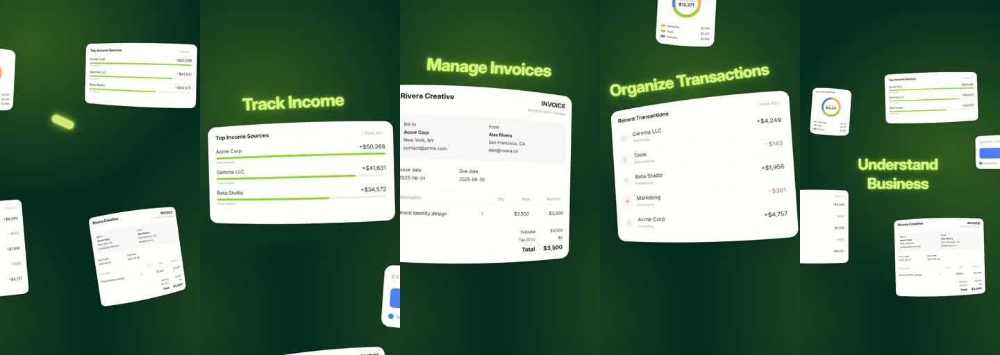

# 财务卡片巡游 · Finance Card Tour

A six-second, editable Remotion reconstruction of the [MotionFace reference](https://motionface.cc/?recording=029698a2-50d4-4a4e-be7f-25eb67f76d90).

**720 × 1280 · 60 fps · 360 frames · silent · Remotion 4.0.534**



White financial dashboard cards move through a dark green space. The camera focuses on income, an invoice, and recent transactions before pulling back to the business overview. Every card, chart, label, glow and movement is authored in React, SVG and frame-based transforms. No reference-video frames are used in the composition.

## Run

Use Node.js 22 LTS or newer and npm. From the repository root:

```bash
npm ci
npm run studio
```

Select **FinanceCardTour** in Remotion Studio. Render the complete MP4:

```bash
npm run render
```

Output: `out/finance-card-tour.mp4` (H.264, 720×1280, 60 fps, six seconds).

```bash
npm run typecheck
npm run still
```

`still` exports frame 300 to `out/preview.png`. On the first render, Remotion downloads Chrome Headless Shell if it is not already available. The bundled font is loaded locally, so the composition itself needs no external media requests. See the [official render CLI documentation](https://www.remotion.dev/docs/cli/render) for additional options.

## Structure and editing

| File | Purpose |
| --- | --- |
| `src/Root.tsx` | Composition size, fps and duration |
| `src/FinanceCardTour.tsx` | Background, curved card renderer, word reveals and scene assembly |
| `src/cards.tsx` | Editable SVG income, invoice, transaction, donut and category cards |
| `src/motion.ts` | Card positions, scale and perspective keyframes, in seconds |
| `public/fonts/` | Bundled Inter variable font and its SIL Open Font License |
| `docs/reference-analysis.md` | Visual analysis, timing and reconstruction choices |

Change the example labels and figures in `cards.tsx`. Change camera timing and positioning in `motion.ts`. Card motion is sampled from the Remotion frame and has no random or wall-clock dependencies. Narrow vector strips give the panels a shallow curved surface without image textures or a 3D runtime.

## Reference and limitations

Recording ID: `029698a2-50d4-4a4e-be7f-25eb67f76d90`.

The original font and 3D scene are unavailable. Inter, the soft glows and the curved panel geometry are visual approximations based on extracted reference frames. The reference contains a silent AAC track with a small encoder tail; this reconstruction uses the exact six-second picture duration and omits the silent audio track.

Source recording, temporary signed URLs, authorization credentials and repository-binding responses are excluded. Font licensing is in `public/fonts/OFL.txt`; Remotion and other dependencies retain their respective licenses. This repository does not claim ownership of the reference design.
